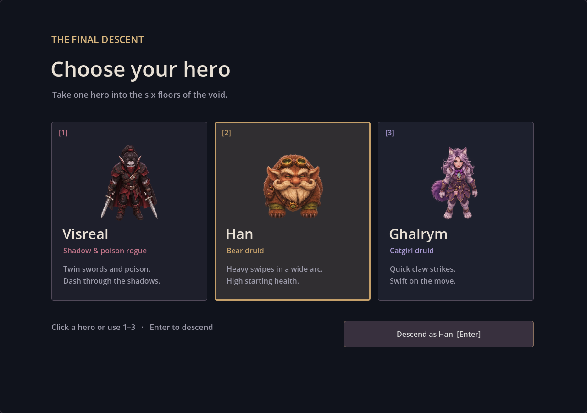

# The Final Descent

A single-player, top-down 2D dungeon crawler with RPG elements, made for Andrew, Davey, and Han's seven-day hackathon.

Choose Visreal, Han or Ghalrym and venture alone through six floors of the void. Each floor has a refuge, three enemy rooms and a guardian’s sanctum. Moving searchlights sweep the Unblinking Court on the last floor.

## How to play

Extract `deliverables/the-final-descent-windows.zip` and open `TheFinalDescent.exe`. Keep the adjacent PCK file with it. From source, import `project.godot` in Godot 4.7.2 and press **F5**. To rebuild the Windows ZIP, run `./tools/package_windows.ps1 -GodotPath 'C:/path/to/Godot_v4.7.2-stable_win64_console.exe'`.

- Click a hero or press **1** for Visreal, **2** for Han or **3** for Ghalrym. Press **Enter** to descend. **WASD** moves your hero. Hold the **arrow keys** to aim and attack independently of movement.
- Visreal uses swords. **E** coats the blades with poison. Hit an enemy, then use **Q** to Shadowstep and slash again to trigger Nightshade.
- Han uses a wide bear swipe and starts with more health. Ghalrym moves faster and attacks with quick claws. For this first pass, their five guardian rewards each add two points of melee damage.
- Walk into a gold gate to advance. Clear every enemy to open the gates. Blue gates lead back to cleared rooms. Your map shows the five rooms and marks the guardian.
- Kills grant XP. Each level increases maximum health and melee damage for this run. Each of the first five guardians equips a different gear slot. Walk onto the central stairs after clearing its sanctum. Each new refuge restores health and cooldowns.
- On floor six, leave the moving beam before exposure fills. Defeat The Witness and its guard to win.
- **Esc** pauses. **R** returns to hero selection. **Enter** retries with the same hero after death or victory.

Visreal’s practice chamber is available in Godot by opening `game/combat.tscn` and pressing **F6**. All three heroes’ animations are available in `previews/characters_preview.tscn`.

## Design

- [Agreed game design](docs/GAME-DESIGN.md)
- [Visreal character brief](docs/characters/VISREAL.md)
- [Han character brief and concepts](docs/characters/HAN.md)
- [Ghalrym character brief and concepts](docs/characters/GHALRYM.md)
- [Official hackathon rules](Hackathon-Official-Rules.md)

Visreal's approved kit and equipment effects are implemented with temporary numbers: **Twin Slashes, Shadowstep, Venom Blades, and Nightshade**; **paired swords** deal poison and shadow damage through melee hits; **armor** reduces incoming damage; **cape** reduces Shadowstep's cooldown; **mask** strengthens poison damage; **trinket** strengthens the shadow strike after Shadowstep. Final numerical balance is deferred until playtesting. Han's gnome-bear v3 and Ghalrym's human-faced catgirl v4 are the chosen visual references; their gameplay skills remain open.

## Hackathon window

Participant: Davey. Start: November 12, 2026, 8:45 p.m. America/New_York.
Finish: November 19, 2026, 8:45 p.m. America/New_York.

The human defines the game and approves major creative decisions. AI may refine ideas and execute agreed tasks. Overnight work is restricted to human-defined and approved issues and necessary supporting work.

## Tools used

- ChatGPT / Codex: planning, design documentation, GDScript implementation, tests, packaging, and repository management.
- Built-in OpenAI image generation: character concepts, revisions, and transparent sprite sheets for Visreal, Han, and Ghalrym.
- Godot 4.7.2: combat runtime, sprite resources, rendering, automated integration checks, and packaging.
- PowerShell: local build automation and Windows ZIP packaging.
- Git and GitHub: version control and project hosting.

Update this list as additional tools are actually used. The rules do not require a per-asset tool mapping.
