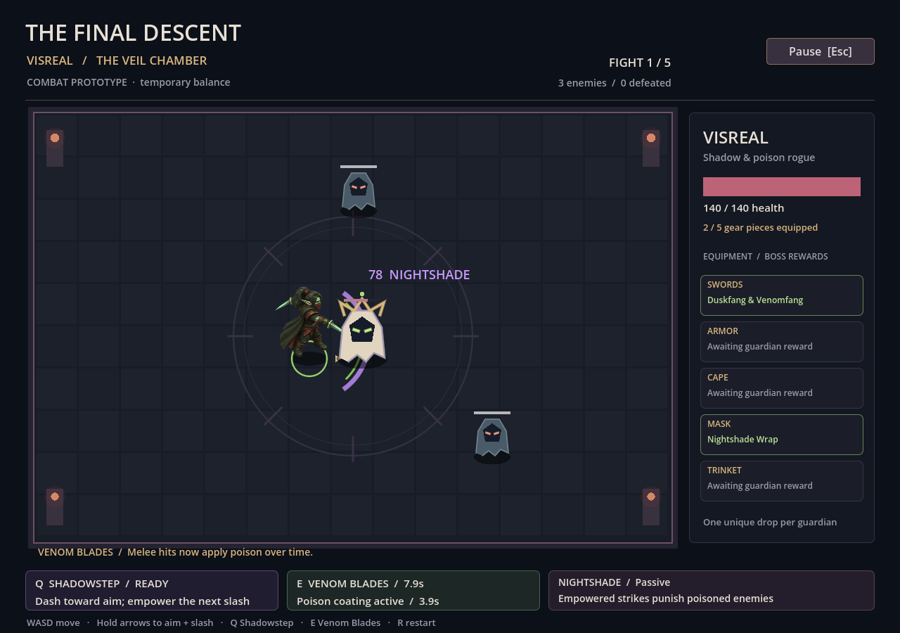

# The Final Descent

A single-player, top-down 2D dungeon crawler with RPG elements, made for Andrew, Davey, and Han's seven-day hackathon.

**Status:** Visreal now has a playable combat prototype: movement, directional melee, Shadowstep, Venom Blades, Nightshade, all five equipment effects, enemies, boss rewards, pause and death/restart. All three heroes also have sprite packs. The six-floor dungeon adventure is still in development.

## How to play

**Windows build:** extract `deliverables/visreal-combat-prototype-windows.zip`, then double-click `TheFinalDescent.exe`. Keep the `.pck` file beside it. No Godot installation is required. Local build archives are not committed to Git; build one from source with `tools/package_windows.ps1` as described in the [prototype guide](docs/COMBAT-PROTOTYPE.md).

**From source:** import `project.godot` in Godot 4.7.2 and press **F5** to play.

- **Enter:** begin / next fight / retry after death.
- **WASD:** move. **Hold arrow keys:** aim and repeatedly melee attack. Combine two arrows to aim diagonally.
- **Q:** Shadowstep toward your last arrow aim; empower the next slash.
- **E:** Venom Blades. Hit an enemy to poison it, then use an empowered slash to trigger Nightshade.
- **Esc:** pause/resume. **R:** restart the run. Close the window to quit.

Five test fights each contain a guardian and two melee enemies. Each guardian automatically equips one random, nonduplicate gear piece. After all five rewards, continue sparring with the full kit. Death ends the run; restarting clears equipment. Health and cooldowns restore between fights. The test fights are not the planned dungeon floors. Numbers and several implementation details are provisional; see the [combat guide and temporary values](docs/COMBAT-PROTOTYPE.md).

To inspect all character sprites, open `previews/characters_preview.tscn` in Godot and press **F6**. Press **1** for Visreal, **2** for Han, or **3** for Ghalrym. Space pauses, Right steps frames while paused, R replays, and T changes the panel backdrop. These are viewer controls, separate from combat controls.

Sprite packs and import instructions: [Visreal](assets/characters/visreal/README.md), [Han](assets/characters/han/README.md), [Ghalrym](assets/characters/ghalrym/README.md). Each includes 5 transparent sheets, 20 animations, 80 frames, a SpriteFrames resource, a visual scene, and atlas JSON. Tested with Godot 4.7.2.

The planned full game's loop is:

1. Choose Visreal the Rogue, Ghalrym the Cat Druid, or Han the Bear Druid. Your chosen hero ventures alone.
2. Start on floor one and descend through six floors.
3. Each floor contains five rooms: one enemy-free spawn room and four rooms with enemies, including a floor boss within that room count.
4. Move and actively use class-based melee attacks. Enemy kills award XP.
5. Leveling increases stats for the remainder of the run.
6. Earn one equipment piece from each of the first five floor bosses in random order with no duplicates, completing all five slots before floor six. The reward order is randomized anew for each run.
7. Face a sixth-floor challenge themed around something the selected class fears or dislikes; its details will be designed later.
8. On death, use the game-over screen to return to the main menu or restart from floor one.

There is no progression between runs in the initial version; earned equipment resets with the run. Visreal's shadow-and-poison skill kit is approved; enemies and bosses, the other heroes' skills, stats, further control behavior, floor-transition details, and the finale are still being designed.

## Design

- [Agreed game design](docs/GAME-DESIGN.md)
- [Visreal character brief](docs/characters/VISREAL.md)
- [Han character brief and concepts](docs/characters/HAN.md)
- [Ghalrym character brief and concepts](docs/characters/GHALRYM.md)
- [Official hackathon rules](Hackathon-Official-Rules.md)

Visreal's approved kit and equipment effects are implemented with temporary numbers: **Twin Slashes, Shadowstep, Venom Blades, and Nightshade**; **paired swords** deal poison and shadow damage through melee hits; **armor** reduces incoming damage; **cape** reduces Shadowstep's cooldown; **mask** strengthens poison damage; **trinket** strengthens the shadow strike after Shadowstep. Final numerical balance is deferred until playtesting. Han's gnome-bear v3 and Ghalrym's human-faced catgirl v4 are the chosen visual references; their gameplay skills remain open.

## Hackathon window

Participant: Davey. Start: November 12, 2026, 8:45 p.m. America/New_York.
Finish: November 19, 2026, 8:45 p.m. America/New_York.

The human defines the game and approves major creative decisions. AI may refine ideas and execute agreed tasks. Overnight work is restricted to human-defined and approved issues and necessary supporting work.

## Tools used

- ChatGPT / Codex: planning, design documentation, GDScript implementation, tests, packaging, and repository management.
- Built-in OpenAI image generation: character concepts, revisions, and transparent sprite sheets for Visreal, Han, and Ghalrym.
- Godot 4.7.2: combat runtime, sprite resources, rendering, automated integration checks, and packaging.
- PowerShell: local build automation and Windows ZIP packaging.
- Git and GitHub: version control and project hosting.

Update this list as additional tools are actually used. The rules do not require a per-asset tool mapping.
