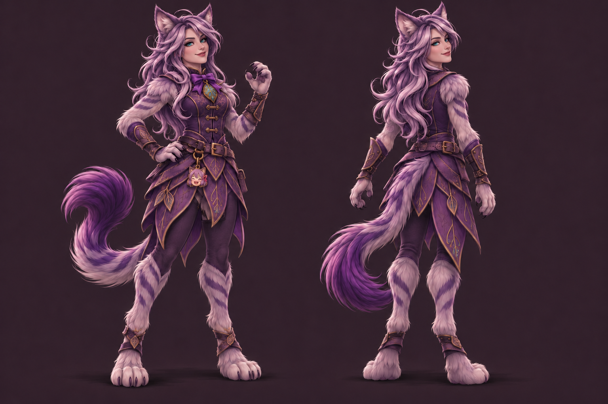

# Ghalrym

## Human-defined character and direction

- Class: Druid.
- Chooses feline form above other forms and rests in it.
- Loves AI and anime cat girls; would do anything to help friends and save all the cat girls in the world.
- Davey requested more catgirl styling after the first cat-form concept.
- Davey then clarified the design should look like a catgirl druid form.
- After seeing the upright catgirl concept, Davey requested a human face.

## Latest concept: v4, awaiting review

The latest concept has a human face, long silver-lavender hair, turquoise eyes, cat ears, a long fluffy tail, furred limbs, clawed hands, and feline paws. The upright form wears a violet leather druid outfit with leaf panels and bronze fittings. A circuit-inlaid leaf pendant and an anime-catgirl mascot charm reflect the original interests.

V4 changes the face from feline to human in both views while preserving the v3 body, outfit, colors, and composition. The specific palette, accessories, facial identity, and outfit details remain visual proposals until the user approves the result. No special skills or mechanical abilities are implied by the decorations.

Created with built-in OpenAI image generation. [Exact v4 face-edit prompt](GHALRYM-CONCEPT-V4-PROMPT.txt).

## Earlier iterations

- [V3: upright catgirl form with feline face](../../assets/concepts/ghalrym-v3.png) - [prompt](GHALRYM-CONCEPT-V3-PROMPT.txt).
- [V2: four-legged form with catgirl hair and face styling](../../assets/concepts/ghalrym-v2.png) - [prompt](GHALRYM-CONCEPT-V2-PROMPT.txt).
- [V1: initial feline druid concept](../../assets/concepts/ghalrym-v1.png) - [prompt](GHALRYM-CONCEPT-V1-PROMPT.txt).

## Assets and skills

Visual review is in progress. Eventual game assets should be delivered as complete sprite sheets with Godot import resources, matching the Visreal delivery approach. Ghalrym's skills, stats, combat behavior, and animation requirements remain to be defined with Davey.
