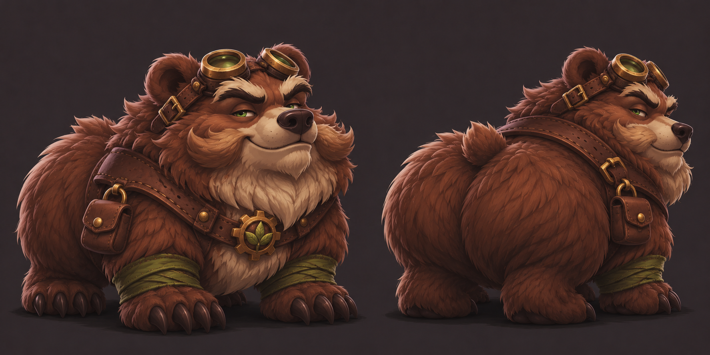

# Han

## Human-defined direction

- Class: Druid.
- Chosen form: bear.
- Defining personality/visual joke: enjoys being a caked-up bear.
- Davey requested Han's visuals next, before returning to Visreal's skills.
- After seeing the first bear concept, Davey requested a more gnome-styled design.

## Latest proposal: v2, awaiting review

The second concept interprets the gnome direction through a compact, squat bear body, short legs, large paws and head, bushy moustache-like cheek fur, and brass goggles. It keeps the exaggerated rounded furry haunches, brown fur, moss-green wraps, and a leather harness with a gear-and-leaf clasp. Two views show the front and rear silhouette.

The goggles, exact proportions, fur/eye colors, pouch, facial fur, and accessory designs are proposed details, not individually specified by Davey. The bear remains in bear form; no humanoid form or mechanical abilities are implied. Awaiting review before making Han's animation sheets.

Created with built-in OpenAI image generation. [Exact v2 edit prompt](HAN-CONCEPT-V2-PROMPT.txt).

## Earlier proposal

[V1: larger bear concept](../../assets/concepts/han-v1.png) - [exact generation prompt](HAN-CONCEPT-V1-PROMPT.txt). Superseded in direction by Davey's request for a more gnome-styled bear.

## Assets and skills

Once the visual design is settled, use the same delivery approach as Visreal: complete transparent sprite sheets with Godot import resources, rather than loose poses requiring later assembly. Han's skills, stats, combat behavior, and animation requirements are not yet defined.
