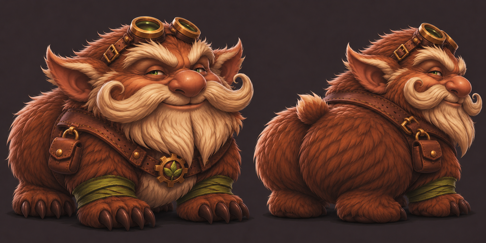

# Han

## Human-defined direction

- Class: Druid.
- Chosen form: bear.
- Defining personality/visual joke: enjoys being a caked-up bear.
- Davey requested Han's visuals next, before returning to Visreal's skills.
- After seeing the first bear concept, Davey requested a more gnome-styled design.
- After v2, Davey asked for a still more gnome-looking bear to better fit Han's personality.

## Approved concept: v3

The third concept emphasizes gnome facial structure: an oversized head, prominent round nose, large sideways-pointing ears, curled handlebar mustache, thick forked cream beard, and expressive eyebrows. It keeps the compact four-legged bear body, broad furry haunches, goggles, moss-green wraps, and gear-and-leaf harness. Two views show the front and rear silhouette. A small correction removed extra round bear ears from the draft so the final design has one pair of ears.

Davey approved v3 as perfect and moved on to Ghalrym's visuals. This is Han's approved visual reference, including its proportions, facial features, colors, and accessories. The bear remains in bear form; no humanoid form or mechanical abilities are implied.

Created with built-in OpenAI image generation. [Exact v3 edit prompt](HAN-CONCEPT-V3-PROMPT.txt) and [anatomy correction prompt](HAN-CONCEPT-V3-CORRECTION.txt).

## Earlier proposal

[V2: squat bear with goggles](../../assets/concepts/han-v2.png) - [edit prompt](HAN-CONCEPT-V2-PROMPT.txt). Davey requested more gnome-like features after this version.

[V1: larger bear concept](../../assets/concepts/han-v1.png) - [exact generation prompt](HAN-CONCEPT-V1-PROMPT.txt). Superseded in direction by Davey's request for a more gnome-styled bear.

## Assets and skills

At Davey's request, a first [Godot-ready sprite pack](../../assets/characters/han/README.md) is now built from the approved design: idle, walk, basic forepaw swipe, hurt, and collapse/death, each with four frames in four directions. It includes transparent PNG sheets, atlas metadata, SpriteFrames and a visual scene. Han's special skills, stats and combat behavior are not yet defined. Base attack poses and playback rates are presentation defaults, not a finalized skill kit.
