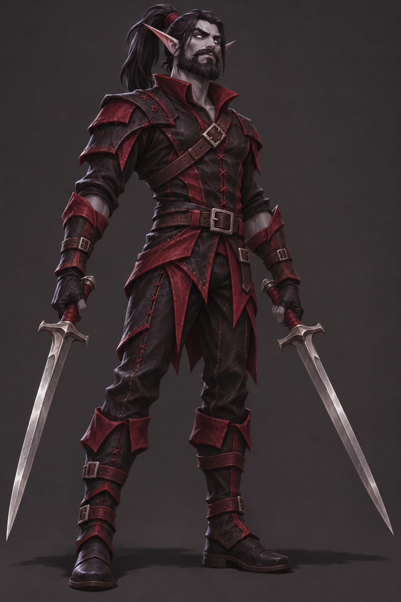

# Visreal

## Human-defined character

- Class: Rogue.
- Race: undead blood elf.
- Height: 6 feet.
- Weight: 200 pounds.
- Facial hair: full beard.
- Hairstyle: long hair tied in a ponytail.
- Equipment: black and crimson leather gear.
- Weapons: dual-wielded swords, one in each hand.
- Personality: gamer, with a darker side; inclined to sneak away and sacrifice his own safety to protect his friends.

## Visual development

The first concept should make the pointed elf ears, full beard, ponytail, leather armor, and two swords easy to read. Keep the face and hair visible so those requested features can be assessed.

Hair color, eye color, skin tone, degree of decay, facial details, and exact armor and sword designs have not been specified. Any choices shown in concept art are provisional visual interpretations, not settled character canon.

Use the game's agreed dark fantasy, World of Warcraft-inspired 2D parody direction. Concept art is a design reference, not an animation-ready sprite.

## First concept: awaiting review

Generated using the built-in OpenAI image-generation tool. [Exact generation prompt](VISREAL-CONCEPT-PROMPT.txt).

The first concept uses dark hair, ash-gray skin, pale luminous eyes, and mild undead facial features as provisional interpretations. Davey has not yet approved these details or the concept as a final design.

## Skills

To be defined by Davey after appearance development. No skill kit or numerical stats are approved yet.
