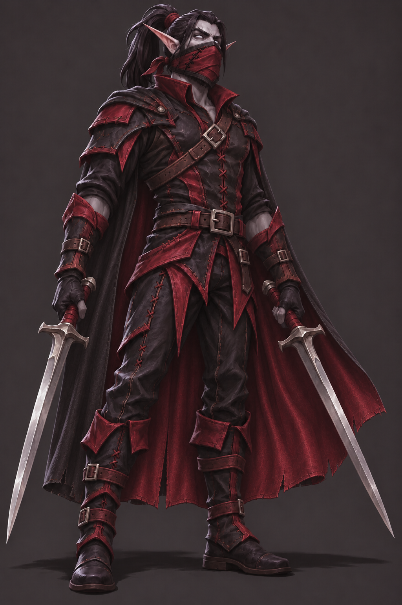

# Visreal

## Human-defined character

- Class: Rogue.
- Race: undead blood elf.
- Height: 6 feet.
- Weight: 200 pounds.
- Facial hair: full beard.
- Hairstyle: long hair tied in a ponytail.
- Equipment: black and crimson leather gear.
- Additions requested by Davey: a cape and a lower-face mask inspired by WoW's Red Defias mask, with an original twist. After seeing v2, Davey requested a slightly longer cape.
- Weapons: dual-wielded swords, one in each hand.
- Personality: gamer, with a darker side; inclined to sneak away and sacrifice his own safety to protect his friends.

## Visual development

Keep the pointed elf ears, ponytail, leather armor, and two swords easy to read. The first concept shows the full beard; later concepts cover the nose and mouth with the requested mask, retaining the beard underneath. Keep eyes and hair visible.

Davey approved the v3 appearance with "Much better" and requested game-ready sprite sheets. V3 is now the visual reference for the first asset pack, including the dark hair, ash-gray skin, pale eyes, mask, and longer cape shown in it.

Use the game's agreed dark fantasy, World of Warcraft-inspired 2D parody direction. Concept art is a design reference, not an animation-ready sprite.

## Approved concept: v3

The revised design adds a black cape with crimson lining and a crimson cloth mask with black binding and asymmetrical X stitches. Version 3 extends the cape slightly beyond v2's length at Davey's request.

Generated using the built-in OpenAI image-generation tool. [V3 edit prompt](VISREAL-CONCEPT-V3-PROMPT.txt).

## Earlier concepts

- [V2: cape and mask](../../assets/concepts/visreal-v2.png) - [edit prompt](VISREAL-CONCEPT-V2-PROMPT.txt).
- V1: original unmasked appearance, below.

Generated using the built-in OpenAI image-generation tool. [Exact generation prompt](VISREAL-CONCEPT-PROMPT.txt).

The original unmasked concept remains available as a face reference; v3 supersedes it for equipment and silhouette.

## Game asset pack

Davey selected Godot and explicitly requested complete sprite sheets ready to import. [Visreal asset pack and import instructions](../../assets/characters/visreal/README.md).

The first pack contains idle, walk, basic dual-sword attack, hurt, and death in four cardinal directions. Davey reviewed the preview and said "it looks good." These support the agreed movement, weapons, and death behavior; special skills and combat numbers remain undecided. Four frames per animation and initial playback rates are implementation defaults, not approved combat timing or balance.

## Skills

To be defined by Davey after appearance development. No skill kit or numerical stats are approved yet.
